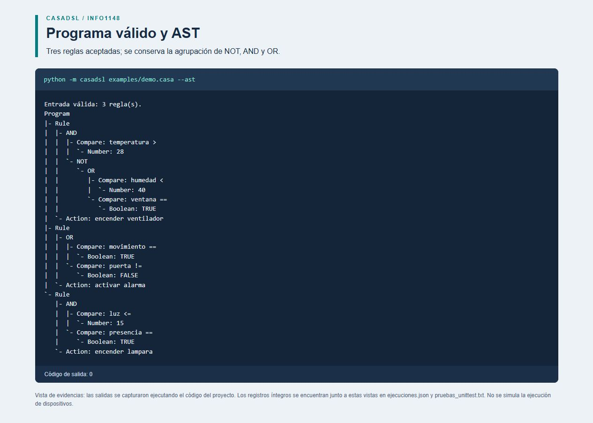
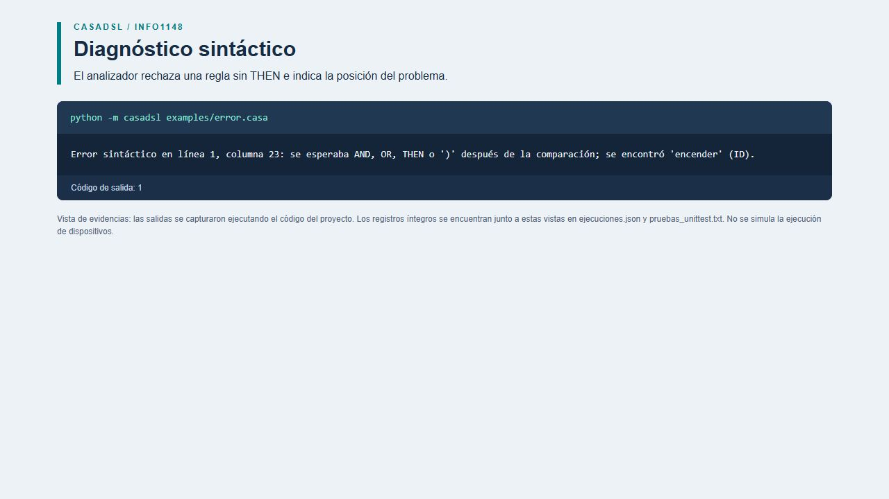
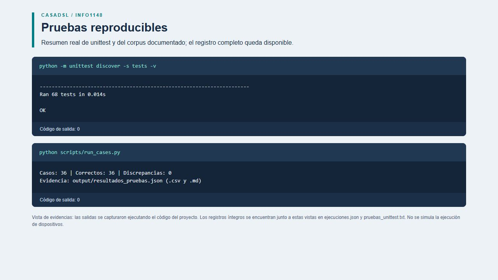

TEORÍA DE LA COMPUTACIÓN / INFO1148

# CasaDSL

### Diseño e implementación de un analizador sintáctico

Lenguaje de reglas para automatización de una casa

Informe de proyecto grupal. Python, gramática libre de contexto, FIRST/FOLLOW, tabla LL(1), descenso recursivo y AST.

| Dato | Información |
| --- | --- |
| Integrantes | José Jiménez, Franco Oyarzo, Demian Quezada |
| Asignatura | Teoría de la Computación - INFO1148 |
| Preparación | 2026-10-29 |
| Repositorio | https://github.com/deimon005/casadsl-analizador-sintactico |
| Validación | 36/36 casos documentados; 68 pruebas automatizadas aprobadas. |

### Resumen

CasaDSL permite describir condiciones sobre sensores y asociarlas con acciones. El sistema convierte el texto en tokens, verifica la gramática y construye un AST. La gramática final tiene 11 no terminales, 18 producciones y una tabla predictiva con 25 celdas ocupadas sin conflictos. La extensión agrega negación y agrupación. Las ejecuciones se conservan como evidencia reproducible.

El proyecto analiza la forma de las reglas. No ejecuta dispositivos ni incorpora validación semántica de sensores, tipos o acciones.

## 1. Introducción y especificación

El dominio elegido es la automatización doméstica. Una regla indica cuándo realizar una acción: por ejemplo, encender un ventilador si una temperatura supera un umbral. El propósito del lenguaje es ofrecer instrucciones pequeñas, legibles y verificables mediante reglas formales.

```text
WHEN temperatura > 28 AND humedad < 40 THEN encender ventilador;
```

### 1.1 Alfabeto y categorías léxicas

El alfabeto relevante incluye letras ASCII A-Z y a-z, dígitos 0-9, guion bajo, los caracteres > < = ! ; ( ) y espacios, tabulaciones y saltos de línea LF/CR/CRLF. La pertenencia al alfabeto no garantiza un token válido: '=' solo no es un comparador admitido. Las reservadas ignoran mayúsculas y los identificadores conservan su escritura.

| Categoría | Definición / ejemplos |
| --- | --- |
| Reservadas (7) | WHEN, THEN, AND, OR, NOT, TRUE, FALSE |
| ID | [A-Za-z_][A-Za-z0-9_]*; temperatura, _sensor1, ventilador |
| NUM | [0-9]+; enteros no negativos; 0, 28, 000 |
| OP_REL | >=, <=, ==, !=, >, < (los compuestos se reconocen primero) |
| Separadores | PUNTO_COMA = ;, PARENT_IZQ = (, PARENT_DER = ) |
| Espacio | [ \t\r\n]+; se descarta conservando la posición |
| EOF | Marcador agregado por el lexer; no se escribe en el programa |

### 1.2 Estructura y decisiones

Cada programa tiene una o más reglas. Cada regla comienza con WHEN, contiene una condición, la palabra THEN, dos identificadores de acción (verbo y objetivo) y termina con ';'. Las condiciones admiten seis comparadores, AND, OR, NOT y paréntesis. Una palabra reservada no puede utilizarse como identificador.

Cada comparación tiene la forma ID OP_REL Valor. No se aceptan condiciones booleanas sueltas, comparaciones encadenadas, asignaciones, decimales, números negativos, cadenas ni comentarios. La semántica de los nombres es externa: 'temperatura > TRUE' es sintácticamente válida en esta gramática, aunque no sería una regla útil sin un análisis de tipos.

## 2. Ejemplos de especificación

Los siguientes ejemplos cumplen el mínimo inicial de cinco entradas válidas y cinco inválidas. La sección de pruebas amplía este conjunto y registra los resultados de ejecución.

| ID | Entrada | Clase | Justificación |
| --- | --- | --- | --- |
| V01 | WHEN temperatura > 28 THEN encender ventilador; | Válida | Comparación mayor que y acción con verbo y destino. |
| V05 | WHEN movimiento == TRUE THEN activar alarma; | Válida | Igualdad con valor booleano verdadero. |
| V07 | WHEN temperatura > 28 AND humedad < 40 THEN encender ventilador; | Válida | Construcción compuesta con AND. |
| V10 | WHEN (temperatura > 28 OR humedad < 40) AND puerta == FALSE THEN activar clima; | Válida | Paréntesis cambian la agrupación frente a la precedencia normal. |
| V11 | WHEN NOT (humo == FALSE AND puerta == TRUE) THEN activar alarma; | Válida | Integración de NOT con agrupación y operador binario. |
| I01 | temperatura > 28 THEN encender ventilador; | Inválida | Falta WHEN al comienzo de la regla. |
| I02 | WHEN temperatura > 28 encender ventilador; | Inválida | Falta la palabra reservada THEN. |
| I03 | WHEN temperatura > THEN encender ventilador; | Inválida | Falta un valor después del operador relacional. |
| I05 | WHEN temperatura > 28 THEN encender ventilador | Inválida | Falta el punto y coma final. |
| I12 | WHEN (temperatura > 28 THEN encender ventilador; | Inválida | Falta el paréntesis de cierre. |

AND y OR constituyen la construcción compuesta base. NOT y los paréntesis forman la extensión elegida y se integran al análisis formal y al parser.

## 3. Gramática libre de contexto

Se define G = (N, T, P, S). El símbolo inicial S es Programa. Los no terminales N son los nombres de la izquierda de las producciones. Los terminales T son categorías de tokens; cada OP_REL representa uno de los seis lexemas relacionales. EOF es un marcador de fin para el algoritmo predictivo, y ε denota la cadena vacía, no un token de entrada.

N = {Programa, RestoPrograma, Regla, Expr, RestoOr, Termino, RestoAnd, Factor, Comparacion, Valor, Accion}.

T = {AND, FALSE, ID, NOT, NUM, OP_REL, OR, PARENT_DER, PARENT_IZQ, PUNTO_COMA, THEN, TRUE, WHEN}.

```text
P01  Programa -> Regla RestoPrograma
P02  RestoPrograma -> Regla RestoPrograma
P03  RestoPrograma -> ε
P04  Regla -> WHEN Expr THEN Accion PUNTO_COMA
P05  Expr -> Termino RestoOr
P06  RestoOr -> OR Termino RestoOr
P07  RestoOr -> ε
P08  Termino -> Factor RestoAnd
P09  RestoAnd -> AND Factor RestoAnd
P10  RestoAnd -> ε
P11  Factor -> NOT Factor
P12  Factor -> PARENT_IZQ Expr PARENT_DER
P13  Factor -> Comparacion
P14  Comparacion -> ID OP_REL Valor
P15  Valor -> NUM
P16  Valor -> TRUE
P17  Valor -> FALSE
P18  Accion -> ID ID
```

La gramática consta de 18 producciones. Las únicas producciones anulables son P03, P07 y P10. Programa no deriva ε, de modo que una entrada vacía no es válida.

### 3.1 Interpretación

Expr combina términos mediante OR; Termino combina factores mediante AND; Factor reconoce NOT, agrupación o comparación. Accion consume exactamente dos identificadores. Las colas permiten repetir reglas y operadores sin recursión izquierda.

## 4. Análisis de la gramática

### 4.1 Recursión izquierda

La gramática final no presenta recursión izquierda directa ni indirecta. Antes de recorrer un ciclo recursivo se consume un terminal: WHEN para repetir reglas, OR o AND para sus colas, NOT para negación y '(' para agrupación. Las cadenas de no terminales iniciales terminan en uno de esos terminales o en ID; no regresan al mismo no terminal sin consumir entrada.

Una formulación alternativa Expr -> Expr OR Termino | Termino sí tendría recursión izquierda. Se reemplaza por Expr -> Termino RestoOr y RestoOr -> OR Termino RestoOr | ε. La versión final usa esta estructura.

### 4.2 Factorización por la izquierda

```text
Versión con prefijo común:
Programa -> Regla Programa | Regla

Versión factorizada:
Programa -> Regla RestoPrograma
RestoPrograma -> Regla RestoPrograma | ε
```

La primera versión comienza con Regla en ambas alternativas, por lo que no permite elegir directamente con un token. La versión final extrae ese prefijo común. Las alternativas de Factor comienzan con NOT, PARENT_IZQ e ID; las de Valor con NUM, TRUE y FALSE. No requieren factorización adicional.

### 4.3 Ambigüedad, precedencia y AST

La separación en Expr, Termino y Factor fija la precedencia: comparaciones, NOT, AND, OR. Los paréntesis permiten cambiar la agrupación. Así, 'a == TRUE OR b == TRUE AND c == TRUE' agrupa el AND dentro del lado derecho del OR. La ausencia de conflictos LL(1) confirma una elección única de producción en cada paso.

Las colas de la gramática recurren por la derecha; el AST se construye mediante acumulación por la izquierda para AND y OR. Esta es una regla explícita de construcción del AST. Los no terminales auxiliares y los paréntesis no aparecen como nodos, pero su efecto se conserva.

## 5. Conjuntos FIRST y FOLLOW

FIRST(A) contiene los terminales que pueden iniciar una derivación de A; incluye ε si A es anulable. FOLLOW(A) contiene los terminales que pueden seguir a A en una forma sentencial; EOF se agrega al símbolo inicial.

| No terminal | FIRST | FOLLOW |
| --- | --- | --- |
| Programa | { WHEN } | { EOF } |
| RestoPrograma | { WHEN, ε } | { EOF } |
| Regla | { WHEN } | { EOF, WHEN } |
| Expr | { ID, NOT, PARENT_IZQ } | { PARENT_DER, THEN } |
| RestoOr | { OR, ε } | { PARENT_DER, THEN } |
| Termino | { ID, NOT, PARENT_IZQ } | { OR, PARENT_DER, THEN } |
| RestoAnd | { AND, ε } | { OR, PARENT_DER, THEN } |
| Factor | { ID, NOT, PARENT_IZQ } | { AND, OR, PARENT_DER, THEN } |
| Comparacion | { ID } | { AND, OR, PARENT_DER, THEN } |
| Valor | { FALSE, NUM, TRUE } | { AND, OR, PARENT_DER, THEN } |
| Accion | { ID } | { PUNTO_COMA } |

### 5.1 Método de cálculo

FIRST se calcula por punto fijo: se agregan los inicios de cada producción y se avanza al siguiente símbolo cuando el anterior es anulable. FOLLOW se inicia con EOF en Programa; para A -> α B β se agrega FIRST(β) sin ε a FOLLOW(B), y si β es anulable se agrega FOLLOW(A). Se repite hasta que ningún conjunto cambie.

### 5.2 Justificaciones representativas

FIRST(Factor) = {NOT, PARENT_IZQ, ID}: son los inicios de sus tres alternativas. FOLLOW(Expr) = {THEN, PARENT_DER}: Expr aparece entre WHEN y THEN, o dentro de paréntesis. FIRST(RestoOr) = {OR, ε}; cuando no llega OR, la alternativa vacía corresponde únicamente a THEN o PARENT_DER.

FOLLOW(Factor) y FOLLOW(Comparacion) incluyen AND, OR, THEN y PARENT_DER. FOLLOW(Valor) hereda esos símbolos por estar al final de Comparacion. FOLLOW(Accion) solo contiene PUNTO_COMA por la forma de Regla. Los once conjuntos se verifican mediante valores esperados independientes en las pruebas.

## 6. Tabla predictiva LL(1)

Para A -> α se ubica la producción en M[A,t] para cada t de FIRST(α) sin ε. Si α es anulable, también se usa cada símbolo de FOLLOW(A). La siguiente tabla presenta todas las entradas ocupadas agrupando anticipaciones que seleccionan la misma producción. Las demás celdas indican error; la matriz completa se incluye en docs/tabla_ll1.csv.

| No terminal | Anticipación | Producción |
| --- | --- | --- |
| Programa | WHEN | P01: Regla RestoPrograma |
| RestoPrograma | WHEN | P02: Regla RestoPrograma |
| RestoPrograma | EOF | P03: ε |
| Regla | WHEN | P04: WHEN Expr THEN Accion PUNTO_COMA |
| Expr | ID, NOT, PARENT_IZQ | P05: Termino RestoOr |
| RestoOr | OR | P06: OR Termino RestoOr |
| RestoOr | PARENT_DER, THEN | P07: ε |
| Termino | ID, NOT, PARENT_IZQ | P08: Factor RestoAnd |
| RestoAnd | AND | P09: AND Factor RestoAnd |
| RestoAnd | OR, PARENT_DER, THEN | P10: ε |
| Factor | NOT | P11: NOT Factor |
| Factor | PARENT_IZQ | P12: PARENT_IZQ Expr PARENT_DER |
| Factor | ID | P13: Comparacion |
| Comparacion | ID | P14: ID OP_REL Valor |
| Valor | NUM | P15: NUM |
| Valor | TRUE | P16: TRUE |
| Valor | FALSE | P17: FALSE |
| Accion | ID | P18: ID ID |

Resultado: 25 celdas ocupadas; 0 conflictos. Cada celda contiene como máximo una producción: la gramática final es LL(1).

En las alternativas anulables: {WHEN} y FOLLOW(RestoPrograma)={EOF} son disjuntos; {OR} y FOLLOW(RestoOr)={THEN,PARENT_DER} son disjuntos; {AND} y FOLLOW(RestoAnd)={OR,THEN,PARENT_DER} son disjuntos. Estas separaciones permiten decidir cuándo consumir y cuándo terminar una cola.

## 7. Diseño e implementación del parser

La implementación utiliza únicamente la biblioteca estándar. El flujo es: texto -> tokenize -> lista de Token con EOF -> Parser.parse -> AST. El lexer adapta la base del notebook proporcionado: conserva su vocabulario, añade posiciones y EOF y admite saltos CRLF. Usa dígitos ASCII explícitos para que el alfabeto quede definido.

| Archivo / función | Responsabilidad y relación formal |
| --- | --- |
| lexer.py / tokenize | Reconocer tokens y conservar línea, columna y desplazamiento. Detectar el primer símbolo no reconocido. |
| parser.py / parse | Consumir Programa y RestoPrograma. Exigir al menos una regla y EOF. |
| rule / action | Reconocer Regla y Accion; exigir WHEN, THEN, dos ID y ';'. |
| expression / term | Reconocer Expr/RestoOr y Termino/RestoAnd con bucles; construir OR/AND. |
| factor / comparison / value | Resolver Factor con una anticipación; reconocer Comparacion y Valor. |
| grammar.py | Calcular FIRST/FOLLOW y la tabla a partir de las producciones; no genera el parser. |
| ast_tools.py | Recorrer el AST y representarlo como texto, JSON o DOT. |
| __main__.py | Leer archivo/entrada estándar, mostrar resultados y devolver códigos de salida. |

expect comprueba el token actual y avanza. Los restos se implementan con bucles y solo aceptan terminar ante un token de su FOLLOW. El parser exige EOF; así evita aceptar un prefijo correcto seguido de tokens sobrantes. Cada alternativa de Factor y Valor se decide con un token, coherentemente con la tabla LL(1).

### 7.1 Recursos y alcance

El reconocimiento es lineal en la cantidad de tokens para entradas dentro de los límites del entorno. La lista de tokens y el AST requieren memoria lineal. La impresión con sangría de un árbol muy profundo puede ocupar más espacio que su número de nodos.

El lexer limita cada número a 1000 dígitos y el parser a 100 llamadas activas de Factor (99 agrupaciones anidadas sobre una comparación son aceptadas). Estos son límites de implementación para producir diagnósticos controlados; la gramática abstracta no impone esas cotas. Las pruebas distinguen los límites de recursos del corpus de equivalencia con LL(1). Las tabulaciones cuentan como una columna y CRLF como un salto de línea.

## 8. AST y manejo de errores

El AST representa el programa mediante Program, Rule, Action, Compare, Number, Boolean, Binary y Not. Los separadores y no terminales auxiliares se omiten. Este árbol se obtiene ejecutando el parser con una entrada válida que combina las dos extensiones:

```text
WHEN NOT (temperatura > 28 OR humedad < 40) THEN activar alarma;

Program
`- Rule
   |- NOT
   |  `- OR
   |     |- Compare: temperatura >
   |     |  `- Number: 28
   |     `- Compare: humedad <
   |        `- Number: 40
   `- Action: activar alarma
```

NOT tiene como hijo la expresión OR completa por efecto de los paréntesis. Action conserva el verbo activar y el objetivo alarma. Se incluyen el AST en texto, JSON y DOT en output/evidencias/.

### 8.1 Diagnósticos reales

I03: Error sintáctico en línea 1, columna 20: se esperaba un valor NUM, TRUE o FALSE después del operador relacional; se encontró 'THEN' (THEN).

I06: Error sintáctico en línea 1, columna 36: se esperaba un identificador de dispositivo después de la acción; se encontró ';' (PUNTO_COMA).

I12: Error sintáctico en línea 1, columna 24: se esperaba ')' para cerrar la agrupación; se encontró 'THEN' (THEN).

X02: Error léxico en línea 1, columna 22: símbolo no reconocido '.'.

El programa se detiene en el primer error. Informa línea y columna y distingue un símbolo desconocido (error léxico) de una combinación de tokens incorrecta (error sintáctico). No implementa recuperación para continuar con errores posteriores.

## 9. Casos de prueba y resultados

El corpus contiene 36 casos y produjo 36 coincidencias con el resultado esperado. Las categorías son disjuntas: los errores léxicos adicionales no sustituyen las entradas sintácticamente inválidas. Los casos límite pueden ser válidos o inválidos según la regla que ejercitan.

| Categoría | Cantidad | Objetivo |
| --- | --- | --- |
| Válidos | 12 | Comparadores, booleanos, múltiples reglas, AND/OR y extensión. |
| Inválidos sintácticos | 12 | Reservadas/separadores ausentes, operandos faltantes, estructura incorrecta y tokens sobrantes. |
| Casos límite | 8 | Vacío, espacios, cero, mayúsculas, CRLF, anidación, ceros iniciales y ';' extra. |
| Errores léxicos adicionales | 4 | Negativos, decimales, identificadores no ASCII y comentarios no admitidos. |

La batería unittest ejecutó 68 pruebas con resultado OK. Además del corpus, comprueba estructura del AST, precedencia y asociatividad, posiciones, mensajes, CLI, límites, FIRST/FOLLOW y tabla. Un reconocedor independiente por pila LL(1) compara sus decisiones de aceptación con las del parser de descenso recursivo en el corpus.

```text
python -m unittest discover -s tests -v
python scripts/run_cases.py
```

En las tablas siguientes, Válida significa aceptación; Sintaxis significa rechazo sintáctico y Léxico rechazo léxico. En todos los casos listados, esperado y obtenido coinciden. La observación documenta el propósito del caso. El JSON/CSV conserva también el diagnóstico completo y las entradas con espacios exactos.

## 9.1 Entradas válidas

| ID | Entrada | Esperado / obtenido | Observación |
| --- | --- | --- | --- |
| V01 | WHEN temperatura > 28 THEN encender ventilador; | Válida / Válida | Comparación mayor que y acción con verbo y destino. |
| V02 | WHEN humedad < 40 THEN activar riego; | Válida / Válida | Comparación menor que. |
| V03 | WHEN luz >= 80 THEN cerrar persiana; | Válida / Válida | Operador compuesto mayor o igual. |
| V04 | WHEN bateria <= 15 THEN activar ahorro; | Válida / Válida | Operador compuesto menor o igual. |
| V05 | WHEN movimiento == TRUE THEN activar alarma; | Válida / Válida | Igualdad con valor booleano verdadero. |
| V06 | WHEN puerta != FALSE THEN encender luz; | Válida / Válida | Desigualdad con valor booleano falso. |
| V07 | WHEN temperatura > 28 AND humedad < 40 THEN encender ventilador; | Válida / Válida | Construcción compuesta con AND. |
| V08 | WHEN humo == TRUE OR temperatura > 60 THEN activar alarma; | Válida / Válida | Construcción compuesta con OR. |
| V09 | WHEN NOT movimiento == TRUE THEN apagar luz; | Válida / Válida | Extensión NOT aplicada a una comparación. |
| V10 | WHEN (temperatura > 28 OR humedad < 40) AND puerta == FALSE THEN activar clima; | Válida / Válida | Paréntesis cambian la agrupación frente a la precedencia normal. |
| V11 | WHEN NOT (humo == FALSE AND puerta == TRUE) THEN activar alarma; | Válida / Válida | Integración de NOT con agrupación y operador binario. |
| V12 | WHEN temperatura > 28 THEN encender ventilador;\nWHEN movimiento == TRUE THEN activar alarma; | Válida / Válida | Programa compuesto por dos reglas. |

## 9.2 Entradas sintácticamente inválidas

| ID | Entrada | Esperado / obtenido | Observación |
| --- | --- | --- | --- |
| I01 | temperatura > 28 THEN encender ventilador; | Sintaxis / Sintaxis | Falta WHEN al comienzo de la regla. |
| I02 | WHEN temperatura > 28 encender ventilador; | Sintaxis / Sintaxis | Falta la palabra reservada THEN. |
| I03 | WHEN temperatura > THEN encender ventilador; | Sintaxis / Sintaxis | Falta un valor después del operador relacional. |
| I04 | WHEN temperatura 28 THEN encender ventilador; | Sintaxis / Sintaxis | Falta el operador relacional. |
| I05 | WHEN temperatura > 28 THEN encender ventilador | Sintaxis / Sintaxis | Falta el punto y coma final. |
| I06 | WHEN temperatura > 28 THEN encender; | Sintaxis / Sintaxis | La acción carece de destino. |
| I07 | WHEN temperatura > 28 THEN 12 ventilador; | Sintaxis / Sintaxis | El verbo de la acción debe ser un identificador. |
| I08 | WHEN () THEN encender ventilador; | Sintaxis / Sintaxis | No se permite una condición vacía entre paréntesis. |
| I09 | WHEN temperatura > 28 AND THEN encender ventilador; | Sintaxis / Sintaxis | AND necesita un factor a su derecha. |
| I10 | WHEN temperatura > 28 < 40 THEN encender ventilador; | Sintaxis / Sintaxis | No se permiten comparaciones encadenadas. |
| I11 | WHEN temperatura > 28 THEN encender ventilador; basura | Sintaxis / Sintaxis | Se rechazan tokens sobrantes después de un programa válido. |
| I12 | WHEN (temperatura > 28 THEN encender ventilador; | Sintaxis / Sintaxis | Falta el paréntesis de cierre. |

## 9.3 Casos límite

| ID | Entrada | Esperado / obtenido | Observación |
| --- | --- | --- | --- |
| L01 | (entrada vacía) | Sintaxis / Sintaxis | Entrada de longitud cero: se exige al menos una regla. |
| L02 | ' \t\r\n  ' | Sintaxis / Sintaxis | Una entrada formada solo por espacios tampoco es un programa. |
| L03 | WHEN x > 0 THEN a b; | Válida / Válida | Identificadores de un carácter y el menor entero no negativo. |
| L04 | wHeN _sensor1 == fAlSe tHeN Apagar Luz_2; | Válida / Válida | Reservadas sin distinción de mayúsculas; identificadores con guion bajo y dígitos. |
| L05 | \tWHEN\r\n x>=10\r\n THEN\tactivar dispositivo;\r\n | Válida / Válida | Separadores mixtos, saltos CRLF y operadores sin espacios. |
| L06 | WHEN NOT NOT (((x == 0))) THEN a b; | Válida / Válida | Negación repetida y tres niveles de agrupación. |
| L07 | WHEN x == 000 THEN a b; | Válida / Válida | Los ceros iniciales son permitidos por la especificación léxica. |
| L08 | WHEN x > 0 THEN a b;; | Sintaxis / Sintaxis | No hay sentencias vacías: un punto y coma adicional es inválido. |

## 9.4 Errores léxicos adicionales

| ID | Entrada | Esperado / obtenido | Observación |
| --- | --- | --- | --- |
| X01 | WHEN temperatura > -1 THEN encender ventilador; | Léxico / Léxico | Los enteros negativos no pertenecen al lenguaje; el signo menos es desconocido. |
| X02 | WHEN temperatura > 28.5 THEN encender ventilador; | Léxico / Léxico | Los números decimales no pertenecen al lenguaje; el punto es desconocido. |
| X03 | WHEN señal == TRUE THEN activar alarma; | Léxico / Léxico | Los identificadores admiten solamente letras ASCII, dígitos y guion bajo. |
| X04 | WHEN x > 1 THEN a b; # comentario | Léxico / Léxico | Los comentarios no forman parte de las extensiones elegidas. |

## 10. Extensión creativa y conclusiones

### 10.1 Negación y agrupación

La extensión permite negar comparaciones o condiciones compuestas y modificar la precedencia con paréntesis. La base ya contiene AND y OR, por lo que la ampliación tiene un efecto observable: NOT (a == TRUE OR b == TRUE) niega el conjunto, mientras NOT a == TRUE OR b == TRUE solo niega la primera comparación.

| Parte | Integración de la extensión |
| --- | --- |
| Gramática | P11: Factor -> NOT Factor; P12: Factor -> PARENT_IZQ Expr PARENT_DER. |
| FIRST/FOLLOW | NOT y PARENT_IZQ pertenecen a FIRST(Factor/Termino/Expr); PARENT_DER aparece en FOLLOW de expresiones y componentes. |
| Tabla LL(1) | Las anticipaciones NOT y PARENT_IZQ seleccionan alternativas distintas; PARENT_DER permite cerrar las colas anulables. |
| Parser y AST | factor implementa recursión controlada, crea Not y reconoce grupos. El árbol conserva el efecto de la agrupación. |
| Pruebas | V09-V11 y L06 ejercitan negación/grupos. I08 e I12 rechazan agrupaciones vacías o sin cierre; pruebas unitarias verifican precedencia. |

### 10.2 Conclusiones

Se obtuvo un lenguaje coherente con los requisitos mínimos y un parser predictivo propio. La factorización y la separación por niveles de precedencia producen una gramática LL(1). El cálculo formal, las funciones del parser y el AST representan las mismas decisiones del lenguaje. Las pruebas documentadas y el reconocedor alternativo no detectaron discrepancias en el conjunto evaluado.

La validez sintáctica no garantiza que una regla sea útil o segura para un dispositivo. Una ampliación futura podría añadir análisis de tipos, un catálogo de sensores y acciones, o ejecución simulada; cada cambio de sintaxis exigiría actualizar gramática, análisis formal y pruebas. La batería aporta evidencia de corrección para los casos revisados, no una demostración exhaustiva de todo comportamiento del software.

Se utilizó IA generativa como apoyo de desarrollo y documentación. El grupo debe revisar y comprender las producciones, cálculos y código, y ser capaz de defenderlos. La guía docs/guia_defensa.md ofrece un recorrido de explicación.

## Anexo A. Ejecución válida y AST

Captura de la vista de evidencias con stdout real del programa de tres reglas. Se verifica aceptación y se representa la estructura sintáctica.



## Anexo B. Detección de errores

Captura de una ejecución inválida. La vista muestra el comando, el diagnóstico real y el código de salida distinto de cero.



## Anexo C. Demostración de pruebas

Captura de los resúmenes reales de unittest y del corpus. El registro completo está en output/evidencias/pruebas_unittest.txt.



## Anexo D. Entrega y reproducibilidad

Repositorio GitHub del código fuente: https://github.com/deimon005/casadsl-analizador-sintactico

Integrantes: José Jiménez, Franco Oyarzo, Demian Quezada

```text
python -m casadsl examples/demo.casa --ast
python -m casadsl examples/error.casa
python -m casadsl --grammar
python -m unittest discover -s tests -v
python scripts/run_cases.py
```

Requisito de ejecución: Python 3.10 o superior, sin bibliotecas externas para parser y pruebas. El informe se regenera con reportlab y Pillow; las capturas se vuelven a obtener de las vistas de evidencias después de cualquier cambio. El README explica formato, ejemplos, archivos y dependencias.

### Archivos auxiliares

docs/gramatica.txt contiene las producciones numeradas; docs/first_follow.json contiene los conjuntos; docs/tabla_ll1.csv contiene la matriz completa; docs/analisis_completo.json conserva el análisis; data/casos.json contiene entradas y expectativas; output/resultados_pruebas.* conserva los resultados; output/evidencias/ incluye registros, AST, vistas y capturas.

### Fuentes del proyecto

1. Material de la asignatura: Proyecto Analisis_Sintactico.pdf, 6 páginas, facilitado por el usuario. Define requisitos, restricciones y entregables.

2. Material de la asignatura: Rubrica_Proyecto.pdf, 2 páginas, facilitado por el usuario. Define criterios y ponderaciones de evaluación.

3. Notebook anlizador_lexico1.ipynb, facilitado por el usuario. Base del análisis léxico; se adaptó con posiciones, EOF, saltos de línea y límites de recursos.

Los documentos de la asignatura orientan el alcance académico. Las salidas, conjuntos y tabla de este informe se derivan de los archivos locales del proyecto y de las ejecuciones conservadas, sin atribuir al material fuente resultados que no contiene.
